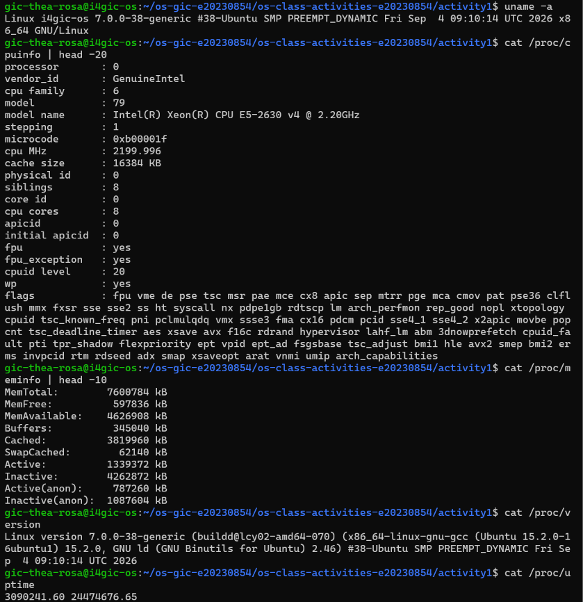

# Class Activity 1 — System Calls in Practice

- **Student Name:** Thea Rosa
- **Student ID:** e20230854
- **Date:** 12 November 2026

---

## Warm-Up: Hello System Call

Screenshot of running `hello_syscall.c` on Linux:

Screenshot of running `hello_winapi.c` on Windows (CMD/PowerShell/VS Code):

Screenshot of running `copyfilesyscall.c` on Linux:

---

## Task 1: File Creator & Reader

### Part A — File Creator

**Describe your implementation:** The library version used fopen(), fgets(), and fclose() to read the file. The system call version used open(), read(), write(), and close() to read and display the file contents directly through the OS.

**Version A — Library Functions (`file_creator_lib.c`):**

<!-- Screenshot: gcc -o file_creator_lib file_creator_lib.c && ./file_creator_lib && cat output.txt -->

**Version B — POSIX System Calls (`file_creator_sys.c`):**

<!-- Screenshot: gcc -o file_creator_sys file_creator_sys.c && ./file_creator_sys && cat output.txt -->

**Questions:**

1. **What flags did you pass to `open()`? What does each flag mean?**

   I used flags O_WRONGLY, O_CREATE, and O_TURNC with open().
	- O_WRONGLY opens the file for writing only.
	- O_CREATE creates the file if it does not already exist.
	- O_TURNC clears the existing contents of th efile before writing and overwrite any previous contents.

2. **What is `0644`? What does each digit represent?**

   0644 is a file permission mode.
	6 = owner can read and write
	4 = group can read only
	4= other can read only
	Therefore the owner has read/write permission, while group and others have read-only permission.
3. **What does `fopen("output.txt", "w")` do internally that you had to do manually?**

   fopen("output.txt", "w") internally opens or crates the file, prpaes buffering, tuencates the file if it alreay exists, and rturns a FILE pointer. Using system calls, I had to manually call open(), write(), and close().

### Part B — File Reader & Display

**Describe your implementation:** The library version used fopen(), fgets(), and fclose() to read the file. The system call version used open(), rea(), write(), and close() to read and display the file contents directly through the operating system.

**Version A — Library Functions (`file_reader_lib.c`):***What is `0644`? What does each digit represent?

**Version B — POSIX System Calls (`file_reader_sys.c`):**

**Questions:**

1. **What does `read()` return? How is this different from `fgets()`?**

   read() returns the numberof bytes actually read.
   A positive value means bytes were read.
   0 means en dof file.
   -1 mean san error occured

   This is different frin fgets(), which returns a pointer to the buffer on success and NULL on failure or end of file.

2. **Why do you need a loop when using `read()`? When does it stop?**

   A file may be larger than the buffer size. Therefore read() may only read part of the file in one call. The loop continues reading until read() returns 0, indicating the end of the file.

---

## Task 2: Directory Listing & File Info

**Describe your implementation:** The library version used printf() to diaplay file information.The system call version used write() to display the formatted ouput. Directory entires were obtained using opendir() and readdir() while file size were obtained using stat().

### Version A — Library Functions (`dir_list_lib.c`)

### Version B — System Calls (`dir_list_sys.c`)

### Questions

1. **What struct does `readdir()` return? What fields does it contain?**

   readdir() return a pointer to a struct dirent.
   Common fields include: 
- d_name: file name
- d_ino: inode number 
- d_type: file type
   The most imortant filed in this activity was d_name which contains the file name.

2. **What information does `stat()` provide beyond file size?**

   stat() provide much more information than file size. It can provide: 
- file size
- ownership information
- permission
- file type 
- inode number 
- last access time
- last modification time
and other file metadat.

3. **Why can't you `write()` a number directly — why do you need `snprintf()` first?**

   write() only outputs bytes. NUmbers must first be converted into text before they cna be displayed. snprinf() formats number into strings, which can then be writtn=en using write().

---

## Optional Bonus: Windows API (`file_creator_win.c`)

Screenshot of running on Windows:

### Bonus Questions

1. **Why does Windows use `HANDLE` instead of integer file descriptors?**

   Windows uses HANDLEs because they ae abstract references to operating system objects (files, process, threads, pipes, etc.) providing more flexibility and security than simple integer file descriptors.

2. **What is the Windows equivalent of POSIX `fork()`? Why is it different?**

   The Windows equivalent os CreateProcess(). It is different because Windows does not duplicate the current process like fork() does. Instead it starts a new process from an excutable program.

3. **Can you use POSIX calls on Windows?**

   Yes but not natively. POXIS calls can be used through compatibility layers such as WSL, Cygwin or other pOXIS-compatible environments.

---

## Task 3: strace Analysis

**Describe what you observed:** 

The library version generated more system activity because the C standard library performs additional work such as buffering and runtime management before invoking actual system calls. The system call version intracted woth the kernel more directly an dproduced simpler traces.
### strace Output — Library Version (File Creator)

<!-- Screenshot: strace -e trace=openat,read,write,close ./file_creator_lib -->
<!-- IMPORTANT: Highlight/annotate the key system calls in your screenshot -->

### strace Output — System Call Version (File Creator)

<!-- Screenshot: strace -e trace=openat,read,write,close ./file_creator_sys -->
<!-- IMPORTANT: Highlight/annotate the key system calls in your screenshot -->

### strace Output — Library Version (File Reader or Dir Listing)

### strace Output — System Call Version (File Reader or Dir Listing)

### strace -c Summary Comparison

<!-- Screenshot of `strace -c` output for both versions -->

### Questions

1. **How many system calls does the library version make compared to the system call version?**

   The library version makes more system calls than direct system call version because the C library performs additional setup and buffering operations.

2. **What extra system calls appear in the library version? What do they do?**

   brk and mmap are used to allocate memory, while fstat obtains information about the file being accessed. These calls support the library's buffering and file management features.

3. **How many `write()` calls does `fprintf()` actually produce?**

   Typically one write() call is produced when the buffer is flushed, even if serveral fprintf() poerations were performed.

4. **In your own words, what is the real difference between a library function and a system call?**

   A system call directly requests a service from the oprating system kernel, while a library function is a higer-level function that may perform extra work and often uses one or more system calls interanlly

---

## Task 4: Exploring OS Structure

### System Information

> 📸 Screenshot of `uname -a`, `/proc/cpuinfo`, `/proc/meminfo`, `/proc/version`, `/proc/uptime`:

### Process Information

> 📸 Screenshot of `/proc/self/status`, `/proc/self/maps`, `ps aux`:

### Kernel Modules

> 📸 Screenshot of `lsmod` and `modinfo`:

### OS Layers Diagram

> 📸 Your diagram of the OS layers, labeled with real data from your system:

### Questions

1. **What is `/proc`? Is it a real filesystem on disk?**

   /proc is a virtual filesystem that provides information about kernel, processes, and system resources. It is not a ral filesystem stored on disk; its contents are generated by kernel at runtime.

2. **Monolithic kernel vs. microkernel — which type does Linux use?**

   Linux uses a monolithic kernel, where core operating system services run in kernel space.

3. **What memory regions do you see in `/proc/self/maps`?**

   Regions include the program text (code), data segment, heap, share libraries, stack, and memory-mapped areas.

4. **Break down the kernel version string from `uname -a`.**

   It shows information such as system name, hostname, kernel version and release number, buuild information, system architecure, and processor type.

5. **How does `/proc` show that the OS is an intermediary between programs and hardware?**

   /proc exposes hardware abd system information through files created by the kernek, allowing programs to access system data without communicationg directly with hardware.

---

## Reflection

What did you learn from this activity? What was the most surprising difference between library functions and system calls?

	I learned that the library and system calls are not the same thing. Library unctions provide a higher-level interface and may perform extra work such as buffering and memory management before making one or more system calls. The most suprising difference was that a simplw library function like fprintf() can generate additional system calls and may buffer output, resulting in fewer actual write() system calls than expected. 
